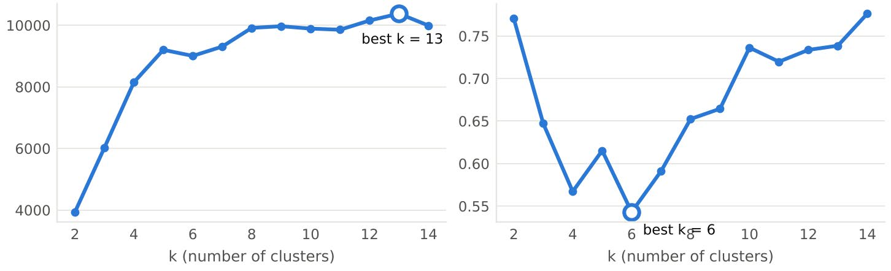
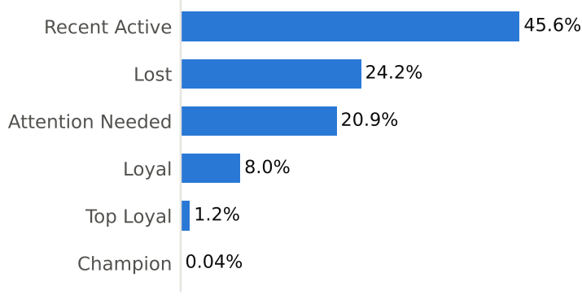
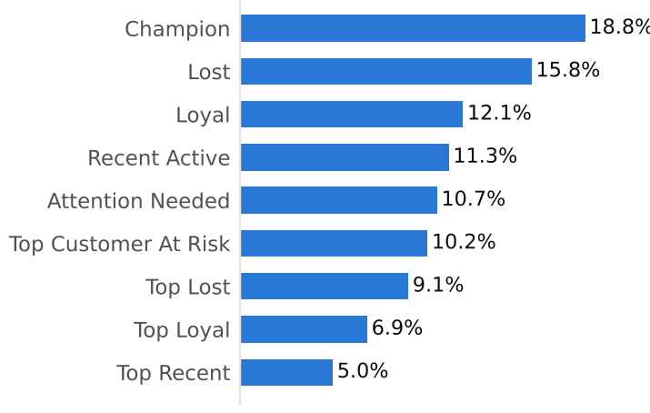
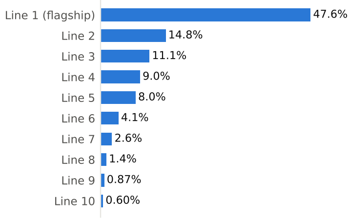
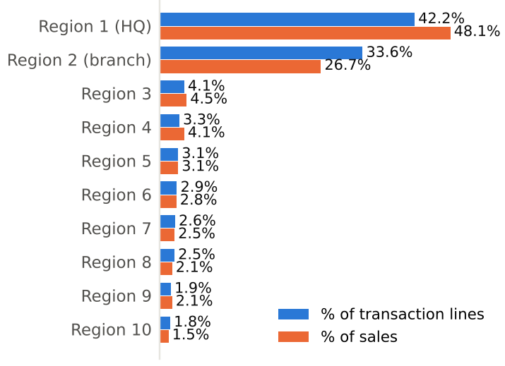
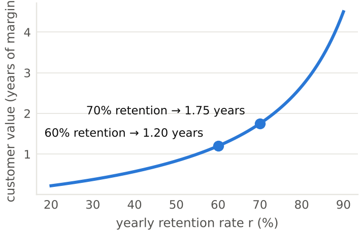

# Customer Segmentation with RFM and K-Means, plus Customer Lifetime Value

My **Master of Data Science dissertation** (HELP University, 2023), rebuilt as a public, privacy-safe project, with a post-dissertation **Customer Lifetime Value (CLTV)** extension.

> *An AI-Based Approach of Customer Data Segmentation Based on K-Means Clustering Algorithms*
> Industry partner: a Malaysian health-products retailer (name withheld under a non-disclosure agreement).

📄 **[Read the 21-page summary (PDF)](Dissertation_Summary_Customer_Segmentation_CLTV.pdf)** · 📓 **[Open the notebook](customer_segmentation_rfm_kmeans_cltv.ipynb)**

---

## The problem
The partner sells health products online and through branches. Its marketing team had five years of transactions but no way to see who its customers were, which ones were drifting away, or where to grow next.

## What I did
| Step | Detail |
|---|---|
| Data | 62,766 B2C transaction lines, 17 fields, 2017 – 2022 |
| Cleaning | Repaired State values from City, merged duplicate language labels, and found **435 hidden duplicate rows** that a standard duplicate check missed (the same item tagged under two product lines) |
| Features | **RFM**: Recency, Frequency and Monetary value for 9,227 customers |
| Modelling | **K-Means** for k = 2 – 14, scored with the **Calinski-Harabasz** and **Davies-Bouldin** indices, under two scalings (Standard, and Standard + MinMax) |
| Rule-based alternative | RFM quantile scores (1 – 4) mapped to 9 business categories that staff can apply without a model |
| Product & region analysis | Product-line concentration and regional shares to support an expansion plan |
| **Extension: CLTV** | **BG/NBD** + **Gamma-Gamma** models implemented from the published formulas with SciPy, with a hold-out check, turned into a ranked action list |


*Standardised RFM: Calinski-Harabasz (left, best k = 13) and Davies-Bouldin (right, best k = 6). I chose k = 6: six segments a marketing team can act on.*

## Key findings (from the dissertation's results, masked)


- **Churn is the main problem:** about **45%** of customers (Lost + Attention Needed) had not bought anything for more than 1.5 years.
- **Value is extremely concentrated:** 4 Champion customers (0.04%) were the biggest spenders; with k = 13 the single top spender formed a cluster of its own.
- **Customers who buy more often spend more:** Frequency–Monetary correlation r ≈ 0.27 – 0.70 across segments.
- **One product line carries the business:** the flagship line held **47.6%** of top-10 product units; the top 3 lines held 73.5%.
- **Two regions dominate:** they made up **75.8%** of transaction lines and 74.9% of sales.
- **Data quality needed work:** 435 hidden duplicates, 29% of records without an e-mail, inconsistent State labels.

| Rule-based categories | Product lines | Regions |
|---|---|---|
|  |  |  |

## Recommendations
1. Market to each segment differently: VIP care for Champion and Top Loyal, reactivation for Attention Needed, low-cost win-back for Lost.
2. Build visit frequency with refills, subscriptions and bundles, because frequency and spend move together.
3. Bundle the flagship line with other lines to reduce dependence on it.
4. Expand into the 3rd – 5th largest regions.
5. With CLTV: protect high-value active customers, contact high-value customers who are drifting away first, and run a second-purchase programme for one-time buyers.

## Customer Lifetime Value extension
RFM describes what a customer *has done*; CLTV estimates what a customer is *worth from now on*. The method is complete and tested on synthetic data with the same structure as the real export; **real-data CLTV results are not reported**.



## Privacy by design
The partner's data stays private and is **not in this repository**. The notebook loads the real export from a folder outside the project, or generates a **synthetic** stand-in if it is missing, and pseudonymises everything straight after loading:
- member IDs, invoices, names, phone numbers and e-mails become keyed pseudonyms (HMAC-SHA256);
- each customer's dates shift by a secret offset (± 30 days); date of birth is reduced to a 5-year band;
- products, prices, cities and states are coded or scaled; business figures are shown only as percentage shares;
- built-in self-checks confirm no real identifier is left. Clusters on camouflaged data matched an uncamouflaged run with an adjusted Rand index of 0.965.

**The outputs saved in the notebook come from the synthetic dataset**, so they show the code running end to end but do not match the dissertation numbers above.

## Run it yourself
```bash
pip install -r requirements.txt
jupyter notebook customer_segmentation_rfm_kmeans_cltv.ipynb
```
With no private data present, the notebook generates `transactions_SYNTHETIC.csv` and runs on that (about 1–2 minutes).

## Tools
Python · pandas · NumPy · scikit-learn (K-Means, scaling, CHI/DBI) · SciPy (BG/NBD, Gamma-Gamma) · Matplotlib · seaborn · Jupyter

## Repository contents
```
├── customer_segmentation_rfm_kmeans_cltv.ipynb   full code, with outputs from a synthetic run
├── Dissertation_Summary_Customer_Segmentation_CLTV.pdf   21-page summary with the real (masked) results
├── images/                                        charts used in this README (from the PDF)
└── requirements.txt
```

*Author: Samuel Lim Wei Howe · Master of Data Science, HELP University (2023)*
